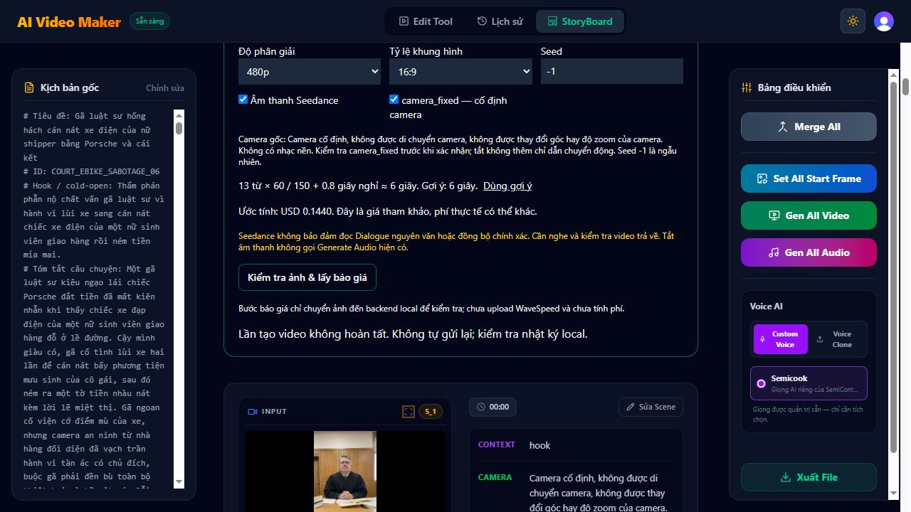

# Upload-only correction verified — 2026-10-16

**The exact scene 3 JPEG now uploads successfully: ticket HTTP 200 and image PUT HTTP 200. No new video prediction was submitted; paid=false.** Diagnostics now preserve sanitized failure details. Corrected response-filename validation and fixed request Content-Length. 292/292 tests, production build and targeted lint PASS.

See [FULL_AI_UPLOAD_DIAGNOSTICS_FIX_REPORT.md](FULL_AI_UPLOAD_DIAGNOSTICS_FIX_REPORT.md) for the three real upload results and the limits of the earlier HTTP-403 diagnosis. The existing FAILED attempt and older UNKNOWN attempt below remain unchanged.

---

# PHASE 5A.2 — Actual authorized attempt FAILED before prediction submission

Updated 2026-10-15, 22:20 Asia/Saigon (15:20 UTC).

**No real video was produced. One authorized Generate click reached the backend and ended FAILED during the upload phase in 510 ms. No Seedance prediction submission was reached. No automatic retry was made.** This result supersedes preparation-only status for this new attempt. The older, pre-journal attempt remains separately UNKNOWN.

## Actual result

| Check | Result | Evidence / limit |
|---|---|---|
| New dedicated backend key verified | YES | Read-only provider balance returned HTTP 200/code 200 using the existing backend DNS-pinned transport. No key is reproduced here. |
| Previous pre-journal attempt | UNKNOWN | No captured provider ID; prediction history returned items=null, which is not a verified empty list. |
| Operator paid approval | YES | New approval for the exact scene/image/settings; then explicit permission: “Cho phép bấm thay đúng một lần”. |
| Fresh real Clerk quote | PASS | Quote at 15:13:37.788Z; image/prompt hashes and USD 0.1440 matched. No synthetic JWT. |
| Existing UI Generate action | EXECUTED ONCE | Local admission persisted at 15:13:52.353Z, before quote expiry. Both consent controls were checked. |
| Durable attempt ID | RECORDED | 453784079c656769af51a6b6effc04bc6e91163f80b4e722 |
| Provider upload | FAIL — completion not established | Last persisted stage UPLOADING, then FAILED. Whether a ticket or image bytes reached the provider is UNKNOWN. |
| Provider prediction | NOT RUN for this attempt | No UPLOADED, SUBMITTING or SUBMITTED event; source persists SUBMITTING before the charged POST. |
| Provider prediction ID | NONE | upstreamId=null. |
| Polling terminal status | NOT RUN | polls=0; local attempt terminal state is FAILED/failed. |
| Video URL/output | NO | url=null. Existing scene videoUrl is an old placeholder and is not a new result. |
| Independently observed billing | No new charge observed | Balance 26.678154 before and after; filtered billing search returned items=[] for the checked interval. This does not resolve the older UNKNOWN attempt. |
| Paid flag restored | PASS | LOCAL_VIDEO_PAID_ENABLED=false; backend restarted with paid=false after terminal failure. |
| Recovery after restart | PASS | Existing authenticated “Tìm / khôi phục lần gửi” and “Khôi phục / kiểm tra trạng thái” displayed this FAILED attempt without submission. |

## Exact input preserved

Project: **Dự án Full AI - 12:33:38 AM**, ID proj_1789061618441. Scene **3 — Thẩm phán**.

Original spoken text, read from legacy Voiceover without migration:

> You relocated it directly under your tires. Ms. Harper, please explain the incident.

Original local image: Editing_photo_room_background_2K_20260910150656.jpeg_2K_20260912152737.jpeg; JPEG, 590,888 bytes, 1536 × 2752. SHA-256: 94304d0e23551917a4e4a9ca44a8f4cc7a59d39f0b22dcca7bf1987be2d0f46b. It was not resized, recompressed or replaced. Final file hash still matches.

Settings: 6 seconds, 480p, 16:9, generate_audio=true, camera_fixed=true, seed=-1. Model: bytedance/seedance-v1.5-pro/image-to-video. Reference estimate USD 0.1440, not a bill.

Prompt SHA-256: 63fc5272ee91a5587ebc504626cabdf05690c082f556463bfaa7102dd0febec4.

Exact temporary prompt shown and quoted:

```text
Use the original authored values below. Do not add or paraphrase spoken dialogue, actions or camera instructions. Only ORIGINAL SPOKEN DIALOGUE is spoken text.

ORIGINAL CONTEXT:
opening

ORIGINAL CHARACTER:
Thẩm phán

ORIGINAL ACTION:
Giữ nguyên góc nhìn của nhân vật, không thay đổi hướng nhìn. Cảm xúc lạnh lùng, dứt khoát lật mở hồ sơ. Cử chỉ tay của nhân vật theo hội thoại và cảm xúc của nhân vật. Không đập búa, không gõ búa, không cầm búa

ORIGINAL CAMERA:
Camera cố định, không được di chuyển camera, không được thay đổi góc hay độ zoom của camera. Không có nhạc nền

ORIGINAL SPOKEN DIALOGUE:
You relocated it directly under your tires. Ms. Harper, please explain the incident.

ORIGINAL TONE:
Nghiêm nghị (Lạnh lùng)
```

All rendered original scene fields before and after are byte-for-byte equal when serialized, including existing media URLs. No save, Firestore update, source rewrite or media replacement was performed. This is a UI field comparison, not a new direct Firestore audit.

## Durable timeline and verified blocker

| UTC time, 2026-10-15 | Persisted event |
|---|---|
| 15:13:37.788 | QUOTED |
| 15:13:52.353 | UPLOADING |
| 15:13:52.863 | FAILED |

The failed boundary is before upload completion is recorded and before prediction submission. The current implementation does **not** retain enough evidence to identify ticket request vs ticket validation vs signed-URL checks vs signed PUT, or to exclude a local error while persisting upload completion. **HTTP status, original error code and failed upload substep: NOT RECORDED.** No specific provider rejection or transport cause is claimed.

Confirmed observability defect from source:

- api/lib/seedance/service.js, runSubmission(): catch maps the error to FAILED and discards the original safe code/status/substep.
- api/lib/seedance/provider.js, data(): non-2xx response becomes UPSTREAM_FAILED without retaining HTTP status. upload() wraps ticket creation, validation, URL checks and PUT in one operation.
- api/lib/seedance/journal.js: no persisted sanitized failure diagnostics. Backend log contains only the startup line.

The current ticket endpoint is documented by WaveSpeed; an endpoint mismatch was not proven. See [official upload API](https://wavespeed.ai/docs/upload-files-api) and [upload guide](https://wavespeed.ai/docs/upload-files). No upload or charged POST was repeated to obtain missing diagnostics. Browser-tool telemetry errors concerning Statsig/Cloudflare are unrelated and are not evidence of a WaveSpeed rejection.

## Read-only reconciliation actually executed

Using the dedicated backend credential without printing it:

- GET https://api.wavespeed.ai/api/v3/balance: HTTP 200/code 200, balance 26.678154, same as pre-attempt.
- POST https://api.wavespeed.ai/api/v3/billings/search (read-only search): HTTP 200/code 200; items is an array, count 0, has_more=false.
- POST https://api.wavespeed.ai/api/v3/predictions (read-only history search): HTTP 200/code 200; items=null. This is an unusable history-list response, not evidence of zero predictions.

Search window: 2026-10-15T15:09:00Z through 2026-10-15T15:16:11.207Z, scoped to the Seedance model. These are point-in-time observations; no invoice for this attempt was available.

## Final runtime and verification

The terminal attempt was preserved through the backend restart. Backend PID 17808 owns the journal writer lock and listens on 127.0.0.1:8790. Vite PID 17280 listens on 127.0.0.1:5173. Both services remain independent of temporary tool-call lifetimes. No Web AI listener is on a LAN/wildcard address. Existing unrelated listeners were not changed.

Final configuration checks: paid=false, backend key present, frontend WaveSpeed key empty. Existing journal checksums and records were preserved during controlled idle-server stops. Only QUOTED/COMPLETED/FAILED records are permitted by the new temporary stop helper; it does not delete the lock or edit jobs. The previously approved stale PID 2164 lock repair remains separate, with its backup/evidence preserved.

Actual local commands in this continuation include:

- node docs/job-recovery/stop-idle-local-video.mjs 6728
- node docs/job-recovery/persistent-local-services.mjs backend (paid=true after explicit approval)
- node docs/job-recovery/stop-idle-local-video.mjs 18260 (after FAILED)
- node docs/job-recovery/persistent-local-services.mjs backend (paid=false)
- node --check docs/job-recovery/stop-idle-local-video.mjs — PASS
- netstat -ano -p tcp — loopback listeners verified
- git status --short — existing tracked/untracked work preserved

Additional checks were direct Node file/hash comparisons and real CUA browser interactions. 72 protected files match the existing protected-before manifest; image hash and original scene field comparison PASS. No production source edit was made for this attempt. Full tests/build/lint were NOT RUN again in this execution-only continuation. The prior job-recovery baseline remains 262/262 tests PASS, build PASS, targeted lint PASS; it is not a claim of a new run.

## Minimal proposed correction — not implemented

1. Add bounded, sanitized failure diagnostics to provider/service/journal: substep, HTTP status where available, allowlisted error code and time. Never persist API keys, authorization headers, signed URLs, raw response bodies or image bytes.
2. Add CPU-only tests for ticket rejection, malformed ticket, URL rejection, PUT rejection, transport error and journal persistence failure; verify restart preserves diagnostics and never repeats a POST. Preserve Clerk, ownership, consent, SSRF and dedupe checks.
3. After approval, perform a controlled upload-only diagnostic using the exact approved image, with generation disabled, to establish the actual failure. Do not infer the cause from the 510-ms duration.
4. Only once the cause is known, make the narrow repair. Any later charged attempt needs new operator approval. Keep this FAILED record; do not delete or edit it to bypass deduplication (same input remains protected by the existing retention policy).

This is a proposal, not authorization for another upload or generation attempt. There is no active provider job to poll for this attempt. Speech accuracy, lip sync, framing, actual output duration and preview/download remain NOT RUN because no result exists.

## Files/evidence

Production source, audio, Gemini, Gateway, Cooking, GPU configuration and Firestore were unchanged by this attempt. The existing ignored .env.video.local paid flag was temporarily enabled after approval, then restored to false. The new operational helper is docs/job-recovery/stop-idle-local-video.mjs; the existing persistent launcher was reused.

Evidence under docs/job-recovery/:

- operator-paid-approval.json
- live-paid-ready-journal.json
- live-paid-operator-click-ready.png
- operator-click-no-admission.png
- paid-attempt-terminal.json
- paid-attempt-scene-integrity.json
- paid-attempt-final-verification.json
- attempt-readonly-diagnostics.json
- paid-attempt-failed-recovered.png
- paid-attempt-terminal-ui.png

Durable record: C:/Users/Admin/AppData/Local/WebAI/VideoAttempts/453784079c656769af51a6b6effc04bc6e91163f80b4e722.json. Do not manually alter it.



---

# Historical report preserved below — older attempts and preparation only

# PHASE 5A.2 — Current outcome, 2026-10-15

**Video NOT AVAILABLE. Paid test outcome UNCONFIRMED. No automatic retry.** This section supersedes the historical preparation statuses below.

- Actual target: Dự án Full AI - 12:33:38 AM, project proj_1789061618441, Scene 3 — Thẩm phán.
- Backend key configured separately from legacy frontend key; authenticated read-only provider history and billing calls returned HTTP 200/code 200. Key never included in this report. The supplied key appeared in chat and should be replaced through the local secure workflow.
- Operator explicitly approved the exact one-video request with “ok”. A fresh real Clerk quote passed after enabling/restarting the local backend. Exact image and prompt hashes matched the approved values. Settings: 6s, 480p, 16:9, audio=true, camera_fixed=true, seed=-1; reference USD 0.1440.
- Both consent boxes checked and Generate Video clicked exactly once. Last observed UI: “Đang upload ảnh và gửi một yêu cầu Seedance…”. This proves initiation in the UI, not successful provider upload or accepted prediction.
- On continuation, no browser tabs, no original backend process/session and no local listeners on 5173/8790 remained. The implementation keeps quotes/jobs only in memory; no captured final response or provider ID was available. Do not infer provider failure, success, or a specific rejection from this.
- Read-only WaveSpeed prediction history lookup returned HTTP 200/code 200, page 1, items=null. Billing lookup returned HTTP 200/code 200, items=[], has_more=false. Both searches filtered the exact Seedance model and 2026-10-14T00:00:00Z to 2026-10-15T17:00:00Z (07:00 Oct 14 to 00:00 Oct 16 in Asia/Saigon). No matching job or charge was returned. This does not establish the upload outcome or an unconditional zero charge.
- Provider upload: UNKNOWN. Provider prediction: UNCONFIRMED / no matching record. Provider job ID: unavailable. Video: NOT AVAILABLE. Actual billing: no matching record found.
- LOCAL_VIDEO_PAID_ENABLED restored to false and read back successfully. Frontend key remains empty in .env.video.local. Backend is stopped; there is no running paid-enabled local listener to restart. No new upload or prediction request was sent during recovery.
- Original source fields and existing media URLs were unchanged in the pre-submit DOM comparison. No agent Firestore writes were performed. Post-attempt saved-scene comparison: NOT RUN because the prior browser session is gone.

## Recovery evidence and commands

Evidence: docs/phase5a2/paid-attempt-recovery-2026-10-15.json (sanitized; no credential).

Actually executed: browser inventory; resume prior exec session (not found); netstat -ano -p tcp filtered for 5173/8790 (none); local env flag write/read verification; POST /api/v3/predictions and POST /api/v3/billings/search using the documented read-only search contracts and existing backend credential. No POST to a generation or media-upload endpoint in this continuation.

Sources: [Prediction history API](https://wavespeed.ai/docs/predictions-api), [Billing search API](https://wavespeed.ai/docs/check-billings). The APIs use POST for read-only searches; these calls do not submit generation jobs.

Changed in continuation: ignored .env.video.local (paid flag false), this report, recovery evidence JSON. No production source changes. Tests/build NOT RUN this continuation; previous verified 248/248 tests, lint and production build remain historical results.

## Remaining blocker

The interrupted local attempt has no durable response/job ID. No output can be recovered from the queried provider history. Do not repeat the potentially charged POST automatically. A further paid attempt needs a separately authorized decision after reconciling provider history. A minimal future improvement would persist sanitized job ID, attempt stage and terminal result locally before returning to the browser, without storing credentials or changing Firestore; this was not implemented in this task.

---

# Historical preparation log (superseded by current outcome above)

# PHASE 5A.2 — First real paid Full AI video test

Status: IN PROGRESS — awaiting the operator-selected reference image. Updated 2026-10-14. No paid action authorized or attempted.

## Actual saved scene

- Project: Dự án Full AI - 12:33:38 AM (`proj_1789061618441`).
- Scene: 3. Character: Thẩm phán.
- Exact spoken text (legacy Voiceover): “You relocated it directly under your tires. Ms. Harper, please explain the incident.”
- UI settings: 6 seconds, 480p, 16:9, generate_audio=true, camera_fixed=true, seed=-1.
- App estimate: USD 0.1440; not a confirmed bill or a successful server quote.
- Read-only rendered scene and prompt saved in `docs/phase5a2/scene-before.json` and `docs/phase5a2/exact-prompt.txt`. These are DOM observations, not a raw Firestore export. No screenplay fields were edited. Existing legacy videoUrl is not evidence of a newly generated video.

## Results to date

| Item | Result | Evidence / limitation |
|---|---|---|
| Local services and proxy | PASS | Backend 127.0.0.1:8790, Vite 127.0.0.1:5173; route checks in local-routes.json. |
| Existing signed-in browser | PASS | Actual saved project and scene rendered in the existing Clerk-authorized Web AI session. |
| Real Clerk authenticated positive quote | NOT RUN | Requires the operator-selected valid image. Signed-in UI alone does not prove a successful quote. |
| Selected image validation | NOT RUN | No image selected in the Generate Video reference input this phase. |
| Backend credential ready | NO | Dedicated WAVESPEED_API_KEY empty. Legacy frontend key not reused. |
| Paid authorization | NOT APPROVED | Exact image, quote and request still require approval. |
| Paid flag false | PASS | Explicit process environment guard; backend key empty. |
| Live paid-disabled submit test | NOT RUN | Requires a valid authenticated quote first. |
| Quote invalidation | NOT RUN | Requires initial quote. |
| Provider upload | NOT RUN | No provider upload attempted. |
| Provider prediction | NOT RUN | No prediction attempted. |
| Video output | NOT AVAILABLE | No new video generated. |
| Actual billing | NOT VERIFIED | No paid call made. |

## Executed checks and commands

The existing source and five requested reports were read. No production source or environment file was edited. Services were launched with an explicit empty frontend/backend provider key and paid=false, using a local-only environment guard under docs/phase5a2.

```text
node --env-file=.env.video.local --import ./docs/phase5a2/require-safe-local-env.mjs scripts/local-video-server.mjs
node --env-file=.env.video.local --import ./docs/phase5a2/require-safe-local-env.mjs node_modules/vite/bin/vite.js --host 127.0.0.1 --port 5173 --strictPort
node --env-file=.env.video.local --import ./docs/phase5a2/require-safe-local-env.mjs docs/phase5a2/check-local-routes.mjs
```

The route helper is a copy of the existing focused check with only the evidence output path changed. Direct/proxied missing session and invalid session returned 401; mismatching origin returned 403. The invalid token is an intentionally invalid string, not a substitute signed JWT or positive authentication test. Served Workspace module returned 200, explicit VITE_WAVESPEED_API_KEY was empty, and the known legacy key was absent. Both listeners were loopback-only. No complete bundle/history credential audit is claimed.

Existing Phase 5A.1D reports state 240 tests passed and build/lint passed. Those suites were NOT rerun in this phase; no production source change warranted a build. Existing frontend credential exposure findings from Phase 5A.1E remain unresolved and outside this task; no rotation or audio changes were performed.

## Immediate operator input

Select an actual matching judge image in Generate Video → Ảnh tham chiếu. Do not use the separate Tải Nền action, which can change the saved project. Requirements: PNG/JPEG, at most 10 MiB, each dimension 32–4096 px, total at most 4,000,000 px. The old 1536×2752 image has 4,227,072 pixels and remains outside the current contract. No compression, resize, crop or image substitution was performed. The operator should also provide the selected filename for the later exact paid approval because the panel clears its file input after reading.

After this input: obtain real authenticated local quote with paid=false, verify image SHA-256, full exact prompt, settings, price and invalidation; compare scene fields; then prepare dedicated backend credential and request the exact single paid authorization. No charge or provider upload before that approval.

## Current provider reference

Official [Seedance model documentation](https://wavespeed.ai/docs/docs-api/bytedance/bytedance-seedance-v1.5-pro-image-to-video), checked 2026-10-14, lists 480p with audio at USD 0.12 per five seconds and linear duration pricing, corresponding to USD 0.144 for six seconds. This is a public reference, not an account-specific bill. Target is POST https://api.wavespeed.ai/api/v3/bytedance/seedance-v1.5-pro/image-to-video. Only public documentation was read; no provider API call was made.

## Files and integrity

Only this progress report and evidence/helpers under docs/phase5a2 were added. Existing tracked/untracked work was preserved. Protected-file check: 80 files checked; 0 changed relative to the start-of-phase baseline (see protected-check.json). This filesystem check is separate from Firestore scene integrity; post-quote scene comparison is pending. No Cooking, Gateway, GPU, Generate Audio, Gemini, Firestore or paid-provider operations were performed.

## Follow-up after operator reported selecting scene 3 image

Browser inspection found no reference preview in the Generate Video panel and the local quote button remained disabled. The saved startFrameUrl now ends in scene_bg_1791987065224.jpeg (previously scene_bg_1791903431294.jpeg); this change was observed after operator interaction, not performed by the agent. Authored Dialogue/legacy Voiceover, Character, Action, Camera, Context, Tone and Translate shown in the panel remain identical. Do not claim all saved fields unchanged: startFrameUrl differs. The agent restored the temporary camera_fixed setting to true and collapsed the read-only scene details to expose the correct reference input. No quote or provider call was attempted. Local quote and image validation remain NOT RUN pending selection in the panel reference input. Evidence: docs/phase5a2/after-operator-image-selection.json and reference-input-still-empty.png.

## Actual selected-image quote attempt

Operator identified Editing_photo_room_background_2K_20260910150656.jpeg_2K_20260912152737.jpeg and asked the agent to select it. Exact file found under C:/Users/Admin/Downloads. After reopening the scene 3 panel, the agent selected this unmodified file through its file chooser, set duration=6 and camera_fixed=true, and clicked the existing local quote button using the real signed-in session. The UI displayed IMAGE_INVALID-equivalent message: “Ảnh PNG/JPEG bị hỏng hoặc vượt giới hạn 10 MiB, 32–4096 px, 4 MP.” No successful quote was returned.

Measured original JPEG: 590,888 bytes; 1536×2752 = 4,227,072 pixels, exceeding the 4,000,000-pixel application limit. SHA-256: 94304d0e23551917a4e4a9ca44a8f4cc7a59d39f0b22dcca7bf1987be2d0f46b. Dimensions read from the original JPEG frame header; no image rewrite or resize. Source api/lib/seedance/images.js applies a 4MP JPEG decode limit and width×height <=4,000,000. Image validation: FAIL. Positive real Clerk quote: FAIL at image-validation stage, not a successful pricing response. Provider upload/prediction: NOT RUN. Paid flag remains false.

Saved startFrameUrl observed on reopening now ends in avatar_1791987357742.jpeg, differing from the earlier baseline before this agent action; authored spoken text and instructions remain visibly unchanged. No Firestore action was performed by the agent. Evidence: selected-image-validation.json and image-validation-blocker.png. Await explicit operator decision on a resized copy or a separately approved validation change; previous instruction forbids automatic resizing and code fixes without approval.

## Preparation requested after image fix (2026-10-14)

Fresh real Clerk quote: PASS via existing UI. Exact operator JPEG hash remains 94304d0e23551917a4e4a9ca44a8f4cc7a59d39f0b22dcca7bf1987be2d0f46b. Scene and prompt match the successful image-fix snapshot, including media URLs. Settings: 6s/480p/16:9/audio=true/camera_fixed=true/seed=-1. USD0.1440 reference estimate reconfirmed against official WaveSpeed pricing (USD0.12 per 5 seconds at 480p with audio, linear duration). Actual billing unknown. Seedance-specific image byte/pixel limits remain undocumented/unverified; no automatic optimization.

Dedicated backend key: NO at preparation check; .env.video.local ignored by Git; operator asked to securely configure a new key, never via chat. Compromised frontend credential will not be reused. Operator paid approval: NO. Upload: NOT RUN. Prediction: NOT RUN. Video output: NOT AVAILABLE. Paid flag remains false. No source, Firestore, production, audio or GPU changes in this preparation. Exact prompt and screenshot: docs/phase5a2/prepared-paid-request.json/.png. Quote expires normally; after approved paid configuration/restart obtain a fresh identical quote before sending one prediction.
