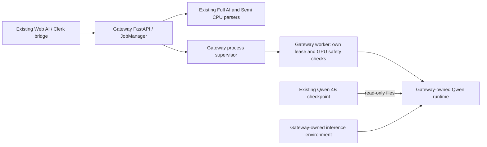

# Phase 4B.1 — Standalone Local AI Gateway Plan

Date: 2026-10-12. Status: **PROPOSED — implementation and GPU activation require separate approval.**

This plan follows the operator's project-isolation correction and supersedes the earlier shared-Cooking-lock design direction. Develop only Web AI and Local AI Gateway on the **current Windows PC / RTX 3060 12GB**. Cooking is a separate application, not a service dependency or coordination participant.

The sole authorized external asset is the existing checkpoint directory, read-only:

`F:/Cooking-AI-review/models/qwen3-vl-4b`

Do not use Cooking's Python environment, application modules, workers, queues, configuration, cache, job directories or lock files in the future standalone runtime. No Cooking changes, source copying, service launch or lifecycle coordination are proposed.

## 1. Current unwanted dependencies — source-confirmed

| Dependency | Current source / behavior | Required removal |
|---|---|---|
| Application root | `ai_gateway/config.py:10` defines `cooking_root`; `worker_config()` forwards it | Replace application-root knowledge with explicit checkpoint and Gateway runtime paths |
| Python environment | `config.py:12` points `inference_python` at Cooking's `.venv`; `ProcessBackend.start()` executes it | Independently provision a Gateway-owned inference environment |
| Application import path | `inference.py:32` prepends the Cooking root to `sys.path` | Never add that root or its packages to the inference import path |
| Loader/registry | `QwenAdapter.start()` imports `app.services.vision_backend_registry.create_backend` | New Gateway-owned loader using upstream libraries directly |
| Memory policy | `QwenAdapter.start()` imports `app.services.dedicated_worker.baseline_gate/postload_gate` | Implement the documented numerical/placement contract locally, without copying Cooking code |
| Output parser | `QwenAdapter.start()` imports `app.services.vision_optimization.parse`; legacy `analysis.analyze()` calls `backend.parse` | Use the already available Gateway `analysis.strict_parse` for the adapter's parser interface; retain exact-source validators |
| Profiling/frame API | `generate()` / `generate_visual()` use the external backend's `generate_profiled`, processor, model and `close()` API; `TextFrames` / `BytesIO` frame wrappers accommodate it | Define a small local runtime interface accepting messages, PIL images, schema and generation limits |
| Application lock | `config.py:13` selects `jobs/.speech_gpu.lock`; `GPUReservation.acquire()` opens/locks it | Remove this dependency only through the approved replacement; never provision or operate the Cooking lock |
| Derived model selection | Visual checkpoint is derived from `cooking_root`; legacy defaults select 8B | Configure the authorized 4B checkpoint directly; no inferred 8B sibling or fallback |
| Runtime inspection helper | `scripts/inspect_runtime.py` acquires the shared reservation, checks CUDA and hashes Cooking application source | Replace with a genuinely CPU-only, Gateway-scoped inspector; do not run the current helper for this task |
| Setup/documentation/tests | README, GPU tests, process failure tests and visual configuration tests encode the old dependencies | Update those contracts and tests together after approval |

These are real application dependencies even though some previous documentation described their use as read-only. Reusing a model directory does not require any of them.

The earlier inspected external backend also supplied attention customization and profiling. That does not authorize copying those implementations. A new loader must define and verify its own behavior against Gateway contracts and upstream APIs.

The Web visual client and bridge call Gateway over authenticated local HTTP. Targeted inspection found no reason to change Set ID, character mapping, screenplay parsers, Firebase, Gemini, Generate Audio or media code to remove the runtime dependencies. Web changes should be documentation only, provided the existing HTTP response/error contracts remain intact.

Evidence: [dependency references](F:/tool-ai-dh/web-ai/docs/phase4b1/standalone-dependencies.json). This was static inspection, not execution of the imported modules.

## 2. Standalone architecture — PROPOSED

There is no Cooking application process or lock in this architecture. The checkpoint remains in its current location; it is not copied, downloaded, edited or used as a writable cache.

### Runtime and environment

- Keep FastAPI's existing CPU environment. Propose a separate `F:/tool-ai-dh/local-ai-gateway/.venv-inference` for GPU dependencies. Creating/installing it is a future approved setup step, not work performed here.
- Use an independent Python installation as the base, not Cooking's interpreter or a copy of its virtualenv. Verify availability before provisioning; no base interpreter was selected or installed in this task.
- Establish independent pinned inference manifests. The previously observed `torch 2.5.1+cu121`, `transformers 4.57.1`, `bitsandbytes 0.50.2`, `accelerate 1.11.0` and `lm-format-enforcer 0.11.3` are candidate compatibility pins, not proof that a new environment runs successfully. Resolve/pin remaining dependencies and CPU image validation deliberately; do not copy Cooking requirement files.
- Worker bootstrap uses an isolated interpreter invocation and adds only the trusted Gateway package root. Do not rely on an inherited `PYTHONPATH` / `PYTHONHOME`, Cooking DLL search path or `site-packages` injection. Explicitly set only the required worker environment; exclude service credentials.
- All cache/temp/log directories stay under Gateway runtime storage. Model access uses `local_files_only=True`, offline settings and `trust_remote_code=False`; validate the canonical checkpoint directory and reject unexpected path redirection. Do not modify the model directory's ACLs as a workaround.
- Keep GPU startup disabled during migration and CPU validation. No silent change from a CPU-only service into a resident model worker.

Proposed configuration contract, for review only: `GATEWAY_INFERENCE_PYTHON` points to the Gateway-owned interpreter; `GATEWAY_VISUAL_MODEL_PATH` explicitly names the authorized checkpoint; `GATEWAY_VISUAL_MODEL_SIZE=4b`; and the new `GATEWAY_GPU_MODE=standalone` means only internal Gateway coordination, never exclusive physical ownership. `GATEWAY_START_GPU_WORKER=false` remains the migration setting. Enabling it later additionally requires `GATEWAY_GPU_TASK=visual_profile` and separate approval. Reject obsolete `GATEWAY_COOKING_ROOT`, `GATEWAY_GPU_LOCK_PATH`, shared/dedicated mode values and implicit legacy model paths with a migration error. CPU-only workflow service operation must not require a usable GPU or model environment. No such configuration was written here.

### Gateway-owned loader

Write `ai_gateway/qwen_runtime.py` independently from the Gateway input/output contracts and public library APIs. Proposed interface: `load()`, `generate(messages, images, output_schema, limits)`, `close()`, plus safe metrics. No `app.services` imports, registry or Cooking frame/request classes.

Load the local Qwen3-VL conditional-generation class and processor with NF4, double quantization, BF16 compute and explicit CUDA device 0. Preserve the post-load CUDA-only requirement; prohibit CPU/disk offload and automatic model substitution. The public quantization API supports these configuration concepts; actual model compatibility still requires later acceptance. [Transformers 4.57.1 bitsandbytes documentation](https://huggingface.co/docs/transformers/v4.57.1/en/quantization/bitsandbytes).

Use upstream SDPA initially rather than copying Cooking's custom attention patch. **This is a proposed behavior difference requiring review**, not an assertion of equivalent peak memory or speed. Retain image/input/output limits and all memory gates, report the actual attention implementation, and stop if real acceptance cannot satisfy them. A clean independent bounded-attention implementation would be separate work if measurements demonstrate a need.

Preserve the visual operation's one image plus fixed appearance prompt, in-memory image normalization, maximum 896-pixel long edge, token preflight, at most 384 output tokens, strict JSON/schema validation, detected/ambiguous/no_human contract and metrics envelope. Do not add screenplay or character names to model input. Schema success alone is not visual-quality success.

The correction authorizes the 4B checkpoint for this work. Keep deterministic Full AI / Semi HTTP parsing unchanged. An explicit legacy GPU script or 8B selection must report unavailable/unsupported under this 4B-only deployment, not silently use 4B or fall back to a Cooking backend. Retaining standalone 8B/legacy inference is a separate scope decision; no claim of preserving that untested GPU path is made.

## 3. Independent Gateway locking — PROPOSED

Use a Windows named mutex for **Gateway worker mutual exclusion only**. No shared file is necessary. Retain the current Gateway mutex name, `Global\LocalQwenGateway_GPU0_Phase1`, during a controlled single-device migration so old and new Gateway instances cannot silently choose different locks. That name is not a Cooking integration. Tests must inject unique test-only names and never acquire this production mutex.

The worker that owns the model acquires the mutex on its owning thread before GPU initialization. Hold it through loading, requests, unload and worker termination; do not release it between requests while the model remains resident. Use immediate or bounded acquisition, no infinite wait. An inaccessible mutex or unexpected object collision fails closed; do not fall back to a session-local or randomly named production mutex.

Permissions must permit the intended Gateway account while preventing unauthorized release/control. Multi-account/session access is a test and deployment requirement, not assumed solved by the name. Abandonment is an error/recovery condition: require fresh process/memory checks, do not treat `WAIT_ABANDONED` as proof of a clean GPU. Windows mutexes have thread ownership and explicit abandonment semantics. [Microsoft mutex documentation](https://learn.microsoft.com/en-us/windows/win32/sync/mutex-objects).

For the worker lifecycle, retain one Gateway-owned child and add a Windows Job Object with kill-on-close, containing **only that child and its descendants**. Bootstrap must wait without importing GPU libraries until its parent has attached it to the job and completed the startup handshake. Failure to establish containment prevents model startup. Keep the supervisor's job handle non-inheritable; never attach existing external PIDs. This lets supervisor failure terminate its own worker instead of leaving an orphan. Job-object operations and permissions require isolated tests on this host. [Microsoft Job Objects documentation](https://learn.microsoft.com/en-us/windows/win32/procthread/job-objects).

Normal shutdown stops new jobs, unloads, waits/reaps the owned child, and releases handles. A timeout or fatal failure may terminate only the owned worker tree after implementation is approved. No background automatic restart loop. Recovery must recheck GPU state; process exit is not evidence that driver memory has already returned to an acceptable baseline.

Ordering: supervisor establishes child containment; worker acquires one Gateway mutex; worker performs admission checks; worker loads. Do not have the parent hold that same mutex while waiting for a child that also needs it. There is no Cooking file-lock ordering or stale-file deletion policy because the new path never touches such a file.

**Guarantee limit:** this prevents overlapping participating Gateway workers. It neither reserves the physical GPU against other applications nor prevents Cooking from starting independently.

## 4. Competing-workload protection — fail closed

Keep the current production checks operational and unchanged until the replacement has been reviewed. The standalone proposal must retain:

| Condition | Required behavior |
|---|---|
| NVIDIA query fails, output is malformed or device identity is inconsistent | Refuse GPU startup |
| Another compute PID, inaccessible ownership or ambiguous classification | Refuse GPU startup; no exemptions based on names |
| Free VRAM below 10,500 decimal MB | Refuse loading; no threshold reduction |
| Baseline used VRAM above the existing default 1,500 MB allowance | Refuse loading; do not introduce a warning-region opt-in |
| CUDA unavailable or CUDA free-memory check fails | Refuse loading |
| Any model placement off CUDA or less than 3,000 MB free after load | Reject readiness and unload the owned worker; retain 3,500 MB as preferred headroom |
| Another workload appears after admission | Stop accepting GPU jobs and shut down only Gateway's worker through its owned lifecycle |
| Unexpected crash / ownership uncertainty | Require revalidation; no inference based on a stale PID, marker or prior success |

Port the numerical policy into Gateway-owned pure functions; do not import or copy Cooking policy functions. Preserve `gpu_snapshot()`'s existing conservative decision input initially. Classification diagnostics may add information for a later review but may not exclude desktop names, unknown PIDs or all processes of the current user.

Recheck immediately before model loading and before subsequent requests. A bounded monitoring design during residence can detect newly reported competition and stop further Gateway work, but must treat probe failure as unsafe. Only the exact current Gateway worker may be excluded from its own snapshot; it is not a reusable PID allowlist. CPU tests must cover PID reuse, probe races and cancellation behavior.

**Current observability limitation:** the read-only observation at **14:21:30 +07:00 on 2026-10-12**, before this correction, reported RTX 3060 / driver 536.23 / WDDM; a separate memory query reported 683 MiB used and 11,445 MiB free. The standard process table listed 13 entries as `C+G`, with per-process memory `N/A`; `pmon -c 1` returned unsupported. These are timestamped observations, not current admission evidence. See [saved observation](F:/tool-ai-dh/web-ai/docs/phase4b1/pre-correction-gpu-observation.json).

NVIDIA documents `C+G` as having both compute and graphics contexts and states per-process memory is unavailable under Windows WDDM. Neither this label nor an application name proves a harmless workload or its current CUDA kernel activity. [NVIDIA process reporting](https://docs.nvidia.com/deploy/nvidia-smi/index.html#processes).

The 14-PID inventory and inaccessible PID in Phase 4B are historical, not merged into that later 13-row table or assumed resolved. No process was terminated or reclassified as safe.

There is an unavoidable gap between a snapshot and an unrelated application allocating memory later. A Gateway mutex and periodic polling cannot enforce machine-wide non-overlap. Removing the Cooking cooperative lock therefore removes that particular inter-application exclusion mechanism; conservative process/memory checks are **not an equivalent physical reservation**. This tradeoff must be approved explicitly, and GPU activation remains blocked where competing usage cannot be established safely.

No desktop allowlist, dedicated-mode switch, driver setting change, Cooking coordination service or external process control is recommended. If the unchanged conservative gate cannot pass on this PC, the correct result remains GPU unavailable while CPU workflows continue. Standalone implementation approval alone does not resolve that availability limit or authorize a weaker policy.

## 5. Exact proposed file changes — Web/Gateway only

All paths below are **PROPOSED**, not modified by this task.

| Gateway file under `F:/tool-ai-dh/local-ai-gateway` | Functions / purpose |
|---|---|
| `ai_gateway/config.py` | `Settings`, `valid`, `from_env`, `worker_config`: remove `cooking_root`/shared-lock settings; require explicit authorized checkpoint, owned interpreter/runtime paths and reviewed standalone policy; safe GPU-disabled migration default |
| `ai_gateway/inference.py` | `QwenAdapter.start/generate/generate_visual/close`, `TextFrames`: replace external backend/policy/parser dependencies with local runtime, policy and existing strict parser; remove Cooking path injection and frame shim |
| `ai_gateway/qwen_runtime.py` — new | Independent `load/generate/close`, processor/model lifetime, constraints and metrics using upstream APIs |
| `ai_gateway/gpu_policy.py` — new | Pure pre-load/post-load threshold and CUDA-placement validation, with existing limits |
| `ai_gateway/gpu.py` | `GPUReservation.acquire/close`: reviewed Gateway-only mutex lifecycle; remove all Cooking file operations. Keep `gpu_snapshot` admission behavior conservative |
| `ai_gateway/process.py` | `ProcessBackend.start/close`: owned interpreter/bootstrap, sanitized environment, contained child startup and reaping |
| `ai_gateway/windows_worker.py` — new | Job-object ownership, bounded child handshake and owned-process cleanup helpers |
| `ai_gateway/worker_bootstrap.py` — new | CPU-only isolated bootstrap; trusted Gateway import root; wait for authorized startup command |
| `ai_gateway/worker.py` | `main`: integrate contained startup/cleanup protocol without changing request/response schemas |
| `ai_gateway/jobs.py` | `health`: report actual configured/runtime model, attention and coordination mode; do not advertise old `sdpa_chunked` behavior for an upstream-SDPA loader |
| `scripts/inspect_runtime.py` | `main`: CPU-only metadata/config inspection, no lease acquisition, Torch/CUDA probe or Cooking-source hashing |
| `requirements-inference.txt`, `requirements-inference-torch.txt`, `requirements-inference.lock.txt` — new | Independently established manifests for the Gateway inference environment; do not change Cooking's installed packages |
| `README.md`, `HTTP_WORKFLOWS.md` | Standalone installation, explicit opt-in, safety limitations, legacy-configuration rejection and rollback instructions |
| `tests/test_gpu_safety.py`, `tests/test_process.py`, `tests/test_visual.py`, `tests/conftest.py` | Replace obsolete shared-Cooking assumptions with isolated test resources; preserve API/image/source-integrity assertions |
| `tests/test_standalone_runtime.py`, `tests/test_gpu_policy.py`, `tests/test_worker_containment.py` — new | Boundary, loader-contract, safety and multiprocess regression tests described below |

Web documentation only: `F:/tool-ai-dh/web-ai/docs/local-visual-id.md` and `docs/local-ai-bridge.md`, to remove Cooking-runtime/shared-lock setup instructions and describe the independent worker. Keep UI, bridge authentication and visual payload/result formats unchanged. If a new public error contract is needed, stop and scope it rather than silently modifying Web behavior.

No changes to `workflow_parser.py`, `web_adapters.py`, `analysis.py` source-integrity rules, visual profile/Set ID components, Full/Semi contracts, Firebase, audio, Gemini, media or WaveSpeed. No files under Cooking are candidates for edits. No implementation patch was generated or applied in this design task.

## 6. CPU-only test plan — NOT RUN

Run these after implementation approval with GPU worker startup disabled and import/load guards. Mock processors/models/snapshots are explicitly software-contract tests, never inference evidence.

| Test group | Expected result |
|---|---|
| Independence | Gateway runs/imports with all Cooking paths and `app.services` imports denied; only the explicitly allowed checkpoint read path is permitted |
| Environment | Worker uses Gateway-owned Python, imports only expected package roots, receives no service/Clerk secrets; offline/cache/temp paths remain Gateway-owned |
| Filesystem boundary | A fake checkpoint can be read with writes denied; attempts to touch Cooking jobs, `.venv`, app source or `.speech_gpu.lock` fail the test |
| Configuration migration | Old Cooking-root/shared-lock settings and unsupported legacy/8B selection fail with a clear configuration error; no silent dedicated mode, fallback or GPU startup |
| Loader calls | Fakes record local-only loading, no remote code, NF4/double-quant/BF16, explicit CUDA mapping, processor messages/schema, token/image bounds and strict output validation |
| Internal contention | Two CPU test-owned processes using a unique injected mutex name cannot overlap; acquisition is bounded; permission failure cannot choose another name |
| Ownership and crash | Test-only owner thread/process crash causes the documented recovery state; no immediate ready result based solely on abandonment |
| Child containment | Test-owned CPU child/grandchild exits on supervisor crash, shutdown and timeout; child cannot begin simulated load before containment succeeds; only retained owned handles are cleaned up |
| GPU policy | Boundary values around 1,500 / 10,500 / 3,000 MB; CUDA placement failure; query timeout/malformed data; unknown and known external PIDs all fail closed as specified |
| Residence monitoring | Mock workload arrival/probe failure prevents new requests; ownership checks handle PID reuse; shutdown is bounded and never targets external processes |
| Compatibility | Existing image response envelope, approval/cancel/scene mapping, exact Full 23 / Semi 22 fixtures and immutable authored fields remain covered; label all vision fakes |
| Static checks | No Cooking application imports/path injection, old lock access, dependency on Cooking interpreter, copied source or unexpected runtime writes |

Existing `test_gpu_safety.py` uses the production global mutex even when its file path is temporary. Existing `test_process.py` includes a real `ai_gateway.worker` launch. **Do not run them unchanged under this task's restrictions.** Refactor/inject isolated resources after approval before running the revised targeted suite. Do not run `scripts/inspect_runtime.py` in its present form.

Only after targeted CPU tests pass should broader Gateway and relevant Web regressions/build/lint run, with explicit guards preventing model/CUDA initialization. The historical **145 Web / 197 Gateway** results were not rerun here.

## 7. Migration, rollback and verified work

### Staged migration — PROPOSED

1. Obtain implementation approval for the exact standalone scope and acknowledged loss of Cooking cooperative locking. Record the existing dirty-worktree hashes/diff; do not reset unrelated work.
2. Implement the Gateway-owned modules, independent configuration and tests with GPU startup disabled. No Cooking service/lock operation and no copied Cooking source.
3. Provision the independent environment only with explicit installation approval. Inspect package metadata and resolve dependencies without initializing CUDA or loading a model. CPU test doubles remain separate from production code.
4. Pass boundary/multiprocess/API regression tests and review the proposed runtime policy. Keep external PID rejection and all VRAM/placement requirements. Reject old settings rather than silently changing their safety meaning. Do not retain a runtime fallback to Cooking.
5. Present a second checkpoint for real GPU activation. A fresh read-only device/process diagnosis and operator-selected real image are required; ambiguous WDDM/ownership data remains blocking. Then, only if separately authorized and admission is safe, load the existing 4B model and measure real quality, latency and VRAM. Live Clerk acceptance remains a separate permitted step, not part of this design.

### Rollback — PROPOSED

Before implementation, record file-specific preimages of Web/Gateway changes. Roll back only those approved changes; preserve unrelated dirty work. Keep GPU startup disabled. Restore prior source for review if needed, but **do not reactivate its Cooking-coupled runtime**, because that would violate the corrected boundary. Continue with the existing CPU parsers.

An independently created inference environment may be retained unused for diagnosis; any later removal must target only that verified Gateway-owned directory. Never restore, delete, recreate or manipulate a Cooking lock or package. No database/media migration exists to undo.

### Already performed in this task

| Work | Result |
|---|---|
| Targeted Gateway/Web dependency and lifecycle source inspection | PASS — unwanted dependencies identified |
| Protected-file before/after hashes | PASS — 44/44 unchanged, including protected Gateway files, prior-read Cooking files, Web generation/UI/Firebase and both original scripts |
| NVIDIA observation before the correction | Read-only, timestamped evidence retained; not a reservation or current readiness decision |
| CPU lock/prototype/multiprocess experiments | NOT RUN — none started before the correction; this corrected task is inspection and design |
| New standalone loader / independent environment / replacement admission | NOT IMPLEMENTED — PROPOSED only |
| Production GPU admission edits or activation | NOT RUN |
| Real GPU reservation / Qwen / Cooking workload | NOT RUN |
| Live Clerk / Firestore / WaveSpeed | NOT RUN |

See [source protection evidence](F:/tool-ai-dh/web-ai/docs/phase4b1/standalone-source-protection.json). Hash verification reads files; it does not execute their modules. No live Cooking lock was created, opened, acquired, deleted or renamed. No production source or configuration changed.

Artifacts written for this work are this plan and `docs/phase4b1/{protected-before.json,standalone-dependencies.json,standalone-source-protection.json,pre-correction-gpu-observation.json}`. The first baseline file began before the correction and was extended with subsequent read-only inspection hashes. No earlier coordination prototype was implemented; the planned shared-lock experiments were abandoned when the operator corrected the boundary.

## 8. Exact approvals required and stop point

**Recommended next approval:** implement a self-contained Gateway loader/environment contract, Gateway-only worker exclusion and contained lifecycle, plus CPU-only validation, on the current PC. No Cooking changes or source copying. No request to move to another PC.

The operator must explicitly approve:

1. **Code implementation:** the Web/Gateway file scope above, removal of Cooking application/lock/interpreter dependencies, and replacement of that cooperative lock with Gateway-only exclusion. This changes coordination semantics and cannot be presented as equivalent physical-GPU ownership.
2. **Loader contract decisions:** independent upstream SDPA instead of Cooking's custom patch, 4B-only initial deployment, and explicit unavailability of legacy/8B GPU operations rather than a hidden external fallback. Full/Semi CPU parsing stays intact.
3. **Environment provisioning, if included:** create/install the Gateway-owned inference virtualenv and independently pinned packages. This is separate from using the existing checkpoint read-only; no model download or copy is authorized or needed.

Implementation approval does **not** approve GPU loading, a real mutex reservation, dedicated mode, PID exemptions, lower thresholds, process/service termination, Cooking operations, live Clerk or Firestore acceptance. Real execution requires a later explicit approval after the remaining workload-safety limitation has been resolved without guessing. If no safe admission can be established, remain unavailable.

**Stop here and wait for explicit operator authorization for Phase 4B.2.** This plan establishes the proposed project boundary and validation work; it does not claim real inference readiness.
